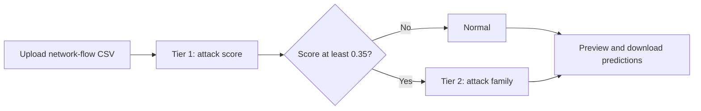

# Network Flow Anomaly Detection

This project examines network traffic records to answer two questions: **Is this flow normal or an attack? If it is an attack, which attack family does it belong to?** It is intended for students and security analysts exploring machine learning for network intrusion detection. The Gradio demo accepts a CSV, displays predictions, and lets the user download the complete results.

The selected pipeline uses two LightGBM classifiers. Tier 1 detects attacks; Tier 2 assigns flagged flows to one of nine families: Analysis, Backdoors, Dos, Exploits, Fuzzers, Generic, Reconnaissance, Shellcode, or Worms. Flows below the detection threshold receive `Normal`.



This is a research demo using recorded network flows. Scores are not calibrated probabilities, and the demo does not capture live traffic.

## Repository layout

| Path | Purpose |
| --- | --- |
| `notebooks/01_data_preparation.ipynb` | Data exploration, preprocessing, training, validation experiments, and final test results |
| `inference.py` | Load saved models, prepare features, and predict labels |
| `evaluate.py` | Evaluate the saved pipeline on a labeled test CSV |
| `app.py` | Gradio GUI with CSV upload, prediction preview, and download |
| `requirements.txt` | Pinned runtime dependencies |
| `documents/` | Figures available for the report |
| `data/UNSW-NB15/` | Local dataset and demo CSV location; CSVs are excluded from Git |
| `models/` | Local trained models and metadata; `.joblib` files are excluded from Git |

## Installation

Use Python **3.11** and run the following commands from a terminal.

```bash
git clone https://github.com/jackrose27/networkanomalydetection.git
cd networkanomalydetection
python3.11 -m venv .venv
source .venv/bin/activate
python -m pip install --upgrade pip
python -m pip install -r requirements.txt
```

On Windows, use `py -3.11 -m venv .venv` and activate with `.venv\Scripts\activate` in Command Prompt or `.\.venv\Scripts\Activate.ps1` in PowerShell.

The runtime dependencies and versions are listed in `requirements.txt`: Gradio, LightGBM, pandas, NumPy, scikit-learn, and joblib. To run all notebook experiments, also install:

```bash
python -m pip install jupyterlab catboost
```

**Reproducibility limitation:** JupyterLab and CatBoost are not pinned in the current requirements file. The commands above install them, but their original experiment versions have not been recorded here. A clean-machine installation and GUI smoke test remain to be verified.

The code uses CPU execution and does not require a GPU. The original CSV has about 2.54 million rows, and the notebook keeps several datasets and transformed copies in memory, so training needs substantially more RAM than running the demo. A minimum RAM requirement has not been measured.

On macOS, if LightGBM reports a missing OpenMP library, install `libomp` with Homebrew (`brew install libomp`) and retry. Keep model training and inference in the same Python environment to avoid serialized-model version mismatches.

## Download and place the data

Dataset: [UNSW-NB15 (Cleaned) on Kaggle](https://www.kaggle.com/datasets/krish4n/unsw-nb15-cleaned). Download and extract the CSV; Kaggle may require an account. Use the cleaned dataset linked here, because other UNSW-NB15 releases can have different columns or category names.

Create the local folders:

```bash
mkdir -p data/UNSW-NB15 models
```

On Windows, create the same folders using File Explorer. Place the extracted dataset at:

```text
data/UNSW-NB15/UNSW-NB15.csv
```

The notebook expects this filename and location. The data has 36 input features plus `Label` (0 for normal, 1 for attack) and `attack_cat` (the family or `Normal`). Categorical inputs are `proto`, `state`, and `service`.

Training, validation, and test data all come from this CSV. The notebook removes exact duplicate rows, then creates a **70% training / 15% validation / 15% test** split, stratified by `attack_cat`, with random seed 42. Category vocabularies and baseline preprocessing are fitted on training data only. After deduplication, the recorded split sizes are 1,377,892 / 295,263 / 295,263 rows.

The CSVs and trained weights are not included in Git. A fresh clone must download the data and follow the training/export steps below, or receive the three trusted model files from the project author.

## Train, validate, and reproduce the experiments

Launch JupyterLab from the notebook directory so its relative data path resolves correctly:

```bash
cd notebooks
python -m jupyterlab 01_data_preparation.ipynb
```

Select the Python environment created above, then run the notebook cells in order. The notebook:

1. Inspects missing values, duplicates, class balance, and label consistency.
2. Removes duplicates and creates the stratified splits described above.
3. Fits one-hot encoding and numerical standardization for a balanced logistic regression baseline.
4. Trains a LightGBM attack detector using numerical features and native categorical features.
5. Uses validation predictions to select a detection threshold maximizing recall under a 1% false positive rate limit.
6. Compares original and balanced LightGBM attack-family classifiers with CatBoost experiments of up to 1,000 and 2,000 iterations.
7. Compares complete pipelines and thresholds on validation data, then evaluates the selected balanced LightGBM pipeline on the held-out test set.

Tier 2 uses known attack rows during training. Its attack-only validation results differ from full-pipeline results, which also include missed attacks and normal flows incorrectly routed to Tier 2.

LightGBM uses 300 estimators, learning rate 0.05, and 31 leaves. The balanced Tier 2 model uses `class_weight="balanced"`. CatBoost uses validation multiclass loss for early stopping and best-iteration selection. Validation comparisons consider attack-family macro F1, detection recall, and false alarms. The final pipeline uses a Tier 1 threshold of **0.35**, selected after comparing validation thresholds. Test results must not be used for further tuning.

### Export the selected models and evaluation inputs

After running the training and final test evaluation cells, run the **last code cell in `notebooks/01_data_preparation.ipynb`**. It exports the selected Tier 1 LightGBM detector, balanced Tier 2 LightGBM classifier, and inference metadata, followed by the held-out test set and a demo sample. Keep the notebook working directory set to `notebooks/`, as in the launch instructions above.

| Exported file (relative to the repository root) | Contents |
| --- | --- |
| `models/tier1_lightgbm.joblib` | Selected binary attack detector (`lgb_model`) |
| `models/tier2_lightgbm.joblib` | Selected balanced attack-family classifier (`tier2_balanced_model`) |
| `models/metadata.joblib` | Feature order, categorical feature names and training vocabularies, and `FINAL_THRESHOLD` (0.35) |
| `data/UNSW-NB15/test.csv` | All rows of the existing held-out `test_df`, including labels, without the pandas index |
| `data/UNSW-NB15/demo_mixed_flows.csv` | A reproducible 100-row sample of `test_df`, using random seed 42, without the pandas index |

The export cell depends on variables created by earlier cells; it cannot run on its own in a fresh kernel. It overwrites the files at these paths. The notebook does not yet show a saved execution count for this cell, and `test.csv` was absent at the time of review. Run the cell before following the evaluation command below. The existing local model files passed feature-order, category-vocabulary, class-weight, and threshold compatibility checks, and inference succeeded on the existing nine-row demo CSV; this does not verify execution of the new export cell.

The exported `test.csv` is the existing held-out split; do not create a new split for final evaluation. The sample CSV is for demonstrating the interface and does not guarantee representation of every rare family. The logistic regression preprocessor saved by the notebook is not needed by the selected LightGBM demo.

## Load models and run predictions

The three files below must be together in `models/`:

```text
models/tier1_lightgbm.joblib
models/tier2_lightgbm.joblib
models/metadata.joblib
```

Only load model files from a trusted source. From the repository root, this example loads the pipeline and saves predictions:

```bash
python -c "import pandas as pd; from inference import load_models, predict_dataframe; models = load_models(); result = predict_dataframe(pd.read_csv('data/UNSW-NB15/demo_mixed_flows.csv'), models); result.to_csv('data/UNSW-NB15/predictions.csv', index=False)"
```

`inference.py` is an importable module, so the example calls its functions directly. Inputs must contain all 36 training features with matching column names; labels are optional for inference. Unseen categorical values become missing categorical values, and numeric columns must contain numeric values. Extra columns are retained in the output.

The output adds `Tier1_Attack_Score`, `Tier1_Prediction` (`Normal` or `Attack`), and `Predicted_Class` (`Normal` or an attack family).

## Evaluate the held-out test set

From the repository root, after exporting models and the test CSV:

```bash
python evaluate.py data/UNSW-NB15/test.csv
```

The test CSV must include `Label` and `attack_cat`. The script prints Tier 1 confusion counts, precision, recall, F1, false positive rate, and average precision, followed by end-to-end per-class precision/recall/F1, attack-family macro F1, and overall accuracy. Average precision summarizes the precision–recall curve; it is the implementation's reported PR summary metric.

Recorded notebook results for the final test split:

| Metric | Result |
| --- | ---: |
| Tier 1 precision | 0.8605 |
| Tier 1 recall | 0.9523 |
| Tier 1 F1 | 0.9041 |
| Tier 1 false positive rate | 0.00679 (0.679%) |
| Tier 1 average precision | 0.9794 |
| End-to-end attack-family macro F1 | 0.5662 |
| End-to-end overall accuracy | 0.9821 |

These are saved notebook outputs, not a fresh rerun. The high overall accuracy must be interpreted alongside macro F1 because normal traffic dominates the data. Analysis and Backdoors remain difficult families, and the test set contains only 25 Worms examples. Random splits within this dataset do not establish performance on future traffic or other networks.

## Running the GUI

1. Complete installation and place the three exported model files in `models/`.
2. Open a terminal in the repository root and activate `.venv` as described above.
3. Run:

   ```bash
   python app.py
   ```

4. Open the local URL printed in the terminal in your browser.
5. Upload `data/UNSW-NB15/demo_mixed_flows.csv` or another CSV with the same feature columns.
6. Click **Analyze network flows**. Read the flow counts, predicted class counts, and first 50 predictions, then download all predictions using the download control.
7. Press `Ctrl+C` in the terminal to stop the demo.

The GUI processes CSVs in chunks of 10,000 rows. A missing-model error means the three model files have not been placed in `models/`; a missing-feature error lists the columns needed in the uploaded CSV. If the error message refers to exporting models from “Step 13,” run the last notebook code cell described above; notebook section 13 currently contains the CatBoost experiment.

## Figures

- [Figure 1: threshold tradeoff](documents/figure1_threshold_tradeoff.png)
- [Figure 2: family F1 comparison](documents/figure2_family_f1.png)
